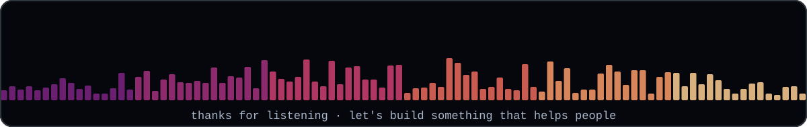

  

  
  
  
  

 

  

<h2 align="center">&nbsp; Project radar</h2>

  

  
  
  

 <b>KinSense</b> is my final year project. It's in active development with 800+ automated backend tests.

 <b>Pakistan Income Tax RAG</b> answers tax questions with retrieval-augmented generation. It's private while I build it.

<h2 align="center">&nbsp; Training log</h2>

  

  

<h2 align="center">&nbsp; Live activity</h2>

  
   Redrawn by GitHub Actions every 6 hours from my real activity.

<h2 align="center">&nbsp; GitHub in numbers</h2>

  
  

<h2 align="center">&nbsp; 7 languages I speak (to computers)</h2>

  
  
  
  
  
  
  

  

<h2 align="center">&nbsp; The snake eats my commits</h2>

  <picture>
    <source media="(prefers-color-scheme: dark)" srcset="https://raw.githubusercontent.com/zainmalik688/zainmalik688/output/snake-dark.svg" />
    <source media="(prefers-color-scheme: light)" srcset="https://raw.githubusercontent.com/zainmalik688/zainmalik688/output/snake.svg" />
    
  </picture>

<h2 align="center">&nbsp; Open to work</h2>

  

  Got an <b>AI or machine learning</b> idea? A project, an app or a research problem? I'd love to build it with you.

<table align="center">
  <tr>
    <th align="center"></th>
    <th align="left">What I can build for you</th>
    <th align="left">Tools I use</th>
  </tr>
  <tr>
    <td align="center"></td>
    <td><b>Machine learning models</b> Classification, prediction, clustering and recommendations</td>
    <td>scikit-learn · TensorFlow · PyTorch</td>
  </tr>
  <tr>
    <td align="center"></td>
    <td><b>Computer vision</b> Image analysis, feature matching, detection</td>
    <td>OpenCV · CNNs</td>
  </tr>
  <tr>
    <td align="center"></td>
    <td><b>Audio AI</b> Sound and speech classification from spectrograms</td>
    <td>TensorFlow · log-mel features</td>
  </tr>
  <tr>
    <td align="center"></td>
    <td><b>LLM and generative AI apps</b> Chatbots, document and resume analysis</td>
    <td>Google GenAI · FastAPI · Streamlit</td>
  </tr>
  <tr>
    <td align="center"></td>
    <td><b>RAG systems</b> AI assistants that answer questions from your own documents</td>
    <td>Python · Retrieval-Augmented Generation · LLMs</td>
  </tr>
  <tr>
    <td align="center"></td>
    <td><b>AI web apps and APIs</b> Secure backends that serve your model</td>
    <td>FastAPI · PostgreSQL · Docker</td>
  </tr>
  <tr>
    <td align="center"></td>
    <td><b>AI-powered mobile apps</b> Android apps connected to an AI backend</td>
    <td>React Native · Expo</td>
  </tr>
  <tr>
    <td align="center"></td>
    <td><b>Optimization</b> Path planning and swarm algorithms</td>
    <td>Python · NumPy · PSO</td>
  </tr>
</table>

  <b>Want to work together?</b> Reach me through the links below and tell me about your idea.

  
  <!-- To add LinkedIn: delete the arrows around the next line and put your link in -->
  <!--  -->

  

