<!-- ============ HEADER ============ -->
<p align="center">
  
</p>

<p align="center">
  <a href="https://git.io/typing-svg">
    
  </a>
</p>

<p align="center">
  
  
  
</p>

---

### 🧑‍💻 `$ whoami`

<table>
<tr>
<td width="58%" valign="top">

```yaml
name:      Muhammad Zain Ul Abidin
studying:  BS Artificial Intelligence @ Bahria University, Islamabad
focus:     [Machine Learning, Deep Learning, Computer Vision]
building:  KinSense — audio distress + location-familiarity alerts
also:      HireMind AI — resume analyzer & interview coach
style:     "Secure first. Test it. Then ship it."
```

- 🔭 Final year project: **KinSense** (FastAPI + React Native + ML)
- 🌱 Learning: **audio deep learning** and **MLOps with Docker**
- 🤝 Up for: **ML, computer vision and backend** collaborations

</td>
<td width="42%" align="center" valign="middle">
  
</td>
</tr>
</table>

---

### 🚀 Featured work

<table>
<tr>
<td width="50%" valign="top">

#### 🛡️ KinSense — Final Year Project
Safety monitoring app for caregivers. The backend detects **audio distress** with a small CNN and learns **familiar places** with DBSCAN over GPS history. It raises alerts with an SOS that still works offline.


*🚧 In active development · 800+ backend tests*

</td>
<td width="50%" valign="top">

#### 🤖 [HireMind AI](https://github.com/zainmalik688/HireMind-AI)
AI resume analyzer and interview coach. Parses **PDF / DOCX** resumes, scores ATS compatibility, finds skill gaps and rewrites bullet points with the **STAR** method.


[→ View repo](https://github.com/zainmalik688/HireMind-AI)

</td>
</tr>
<tr>
<td width="50%" valign="top">

#### 🐝 [Swarm Path Planning (PSO)](https://github.com/zainmalik688/swarm-pathplanning-075)
Particle Swarm Optimization finding obstacle-free paths on a seeded 25×25 grid. Its best path is only **0.5 % longer** than the straight-line lower bound, with **0 collisions**.


[→ View repo](https://github.com/zainmalik688/swarm-pathplanning-075)

</td>
<td width="50%" valign="top">

#### 👁️ [Computer Vision Lab](https://github.com/zainmalik688/COMPUTER-VISION)
Hands-on computer vision tasks with OpenCV, starting with **ORB feature detection and matching** between an image and its rotated copy.


[→ View repo](https://github.com/zainmalik688/COMPUTER-VISION)

</td>
</tr>
</table>

---

### 🛠️ Tech stack

<p align="center">
  <b>Languages</b><br/>
  <br/><br/>
  <b>AI / ML</b><br/>
  <br/><br/>
  <b>Backend · Mobile · Tools</b><br/>
  
</p>

---

### 📊 GitHub stats

<p align="center">
  
  
</p>

<p align="center">
  
</p>

---

### 🐍 Watch the snake eat my contributions

<p align="center">
  <picture>
    <source media="(prefers-color-scheme: dark)" srcset="https://raw.githubusercontent.com/zainmalik688/zainmalik688/output/snake-dark.svg" />
    <source media="(prefers-color-scheme: light)" srcset="https://raw.githubusercontent.com/zainmalik688/zainmalik688/output/snake.svg" />
    
  </picture>
</p>

---

### 🤝 Let's connect

<p align="center">
  I'm open to collaborating on <b>machine learning</b>, <b>computer vision</b> and <b>AI-powered apps</b>.<br/>
  <a href="https://github.com/zainmalik688"></a>
  <!-- Add your LinkedIn: remove the arrows on the next line and put your link in -->
  <!-- <a href="https://www.linkedin.com/in/YOUR-LINKEDIN"></a> -->
</p>

<!-- ============ FOOTER ============ -->
<p align="center">
  
</p>
